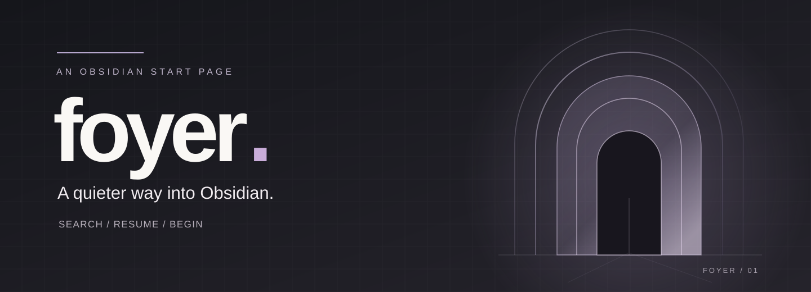
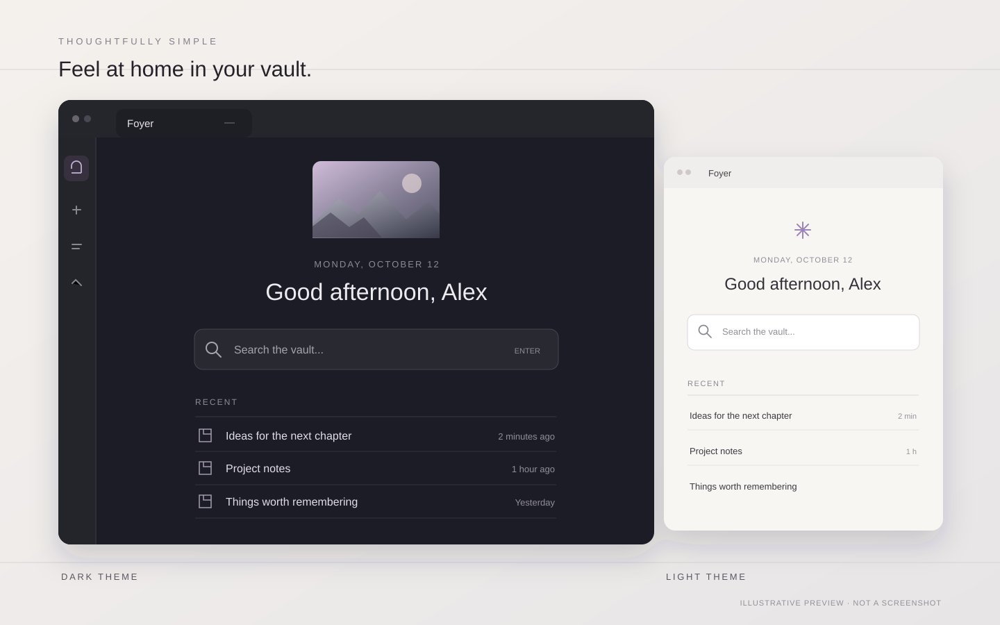

<p align="center">
  
</p>

# Foyer

<p align="center">
  <strong>Your notes, one quiet starting point.</strong><br>
  A minimal, personal home screen for <a href="https://obsidian.md/">Obsidian</a>.
  Open a new tab, find what matters, and pick up where you left off.
</p>

<p align="center">
  <a href="https://github.com/ToniLopezPhoto/foyer/releases/latest">Download</a>
  &nbsp;·&nbsp;
  <a href="#installation">Installation</a>
  &nbsp;·&nbsp;
  <a href="#features">Features</a>
  &nbsp;·&nbsp;
  <a href="#español">Español</a>
</p>

<p align="center">
  <a href="https://github.com/ToniLopezPhoto/foyer/releases/latest"></a>
  
  <a href="LICENSE"></a>
</p>

---

Most start pages want to be a dashboard. **Foyer is simply a place to begin.**

It replaces Obsidian's empty new tabs with a welcoming space that feels like a natural part of your vault. There are no widgets to configure, no feeds to follow, and no extra services to connect: just search, recently opened notes, and a little room to breathe.

<p align="center">
  
</p>
<p align="center"><sub>Interface illustration, not an application screenshot. Foyer inherits the colors and typography of your active Obsidian theme.</sub></p>

## What's new

The full history is in [CHANGELOG.md](CHANGELOG.md).

### What's new in 1.2

- **A board of sticky notes for the notes you use every day:** pin a note from the file menu (right-click it) or with the commands **Pin current note to Foyer** and **Unpin current note from Foyer**, or with the pin icon that appears when you point at a note in Recent, and it appears as a square card above Recent. Cards show only the note title and its folder, with the same type as Recent, tilt slightly, lift when you point at them, and can take a border color from your theme's palette. Right-click a card to open it, open it in a new tab, change its color or unpin it. Drag cards to reorder them (on touch, press and hold first), or select one and use `Alt` + arrow keys. Pins, colors and order follow renames and sync across your devices with the rest of the plugin settings.
- **Tidy your Recent list:** hover a row and press **✕**, or press `Delete` on the selected row, to remove it from Recent. This only removes the history entry; your note is never deleted. **Clear Recent history** (command palette or settings) empties the list on this device.
- **New commands:** **Focus Foyer search** puts the cursor in the search box, opening Foyer first if needed, and **Open Foyer in a new tab** opens another Foyer next to the one you have.
- Pinned notes are not repeated in Recent, and the Recent limit still applies to Recent.

### What's new in 1.1.2

- **Clearer directory listing:** the plugin description now says what Foyer does, and the install instructions below start with the Obsidian Community directory.
- **Tidier search box:** the placeholder ends in a single ellipsis (`Search the vault…`, `Buscar en el vault…`) instead of four dots.
- **Contributor docs:** new [CHANGELOG.md](CHANGELOG.md) and [CONTRIBUTING.md](CONTRIBUTING.md).

### What's new in 1.1.1

- **Verifiable releases:** release files are published with GitHub build provenance attestations (see [Privacy, by design](#privacy-by-design)).
- **Vault access disclosure:** the README now explains exactly how Foyer lists your vault files to power search.
- No change in plugin behavior.

### What's new in 1.1

- **Settings you can change:** choose whether Foyer opens at startup, whether it replaces empty new tabs, and how many recent notes and search results are shown (3 to 20 each).
- **Recent notes from your history:** the list follows the notes you opened, and you can move through it with the keyboard when the search box is empty.
- **Smarter search:** matches frontmatter `aliases`, skips notes hidden by Obsidian's **Excluded files**, prefers recently opened notes when names tie, and stays fast on large vaults.
- **Create notes in folders:** type `Projects/Ideas/Plan` to create the note in folders that are created as needed.
- **Accessibility:** the search box and its results follow the combobox and listbox pattern for screen readers, and search results show Obsidian's hover preview.
- **Fixes:** typing `idea.md` opens or creates `idea.md`, not `idea.md.md`.

## Features

### Find a thought, instantly

Search note titles, file paths, and aliases with fuzzy matching. Notes that Obsidian excludes in **Settings → Files and links → Excluded files** do not appear. Use the keyboard to move between matches, open a note, search within content, or create a new note directly from a query.

### Continue where you left off

Your recent notes reflect **when you actually opened them**, not when they were last edited. Relative timestamps stay fresh while Foyer is open, and history follows notes when you rename or move them. The history stays on this device and is not synced. Remove a note from Recent with its **✕** or the `Delete` key, or clear the list from the command palette; your notes are never touched.

### Keep a few notes at hand

Pin the notes you open all the time and they wait for you as a board of square sticky notes above Recent. Pin a note with the pin icon that shows when you point at it in Recent, from the file menu, or with a command. Each card shows the note's title and folder in the same type as Recent (Foyer never reads the contents of your notes to draw it), leans a little to one side, and straightens and lifts when you point at it. Give a card a border color from your theme's palette (yellow, orange, red, purple, blue, cyan, green or pink) from its right-click menu, or leave it neutral. The board is a responsive grid, about five cards per row on a wide pane and two on a phone. Drag a card to put it where you want it: with a mouse just drag, on touch press and hold for a moment first. With the keyboard, select a card and press `Alt` + an arrow key; a screen reader announces its new position. Only the order is stored, so your board looks right on every screen, and it is saved with the plugin settings so it follows you across devices. If you prefer less motion, Foyer respects your system's reduced-motion setting.

### Make the space yours

A greeting changes with the time of day and can include your name. Add a personal image from your vault or upload one from your computer; leave it unset for a small accent-colored symbol instead.

### Fit right into Obsidian

Foyer uses the active theme's colors and typography, works in light and dark modes, and supports English and Spanish. It opens at startup and fills otherwise empty new tabs. Desktop and mobile are supported.

## Keyboard shortcuts

| Shortcut | Action |
| --- | --- |
| `↑` / `↓` | Move through search results, or through Pinned and then Recent when the search box is empty |
| `Alt` + `←` `↑` / `→` `↓` | Move the selected pinned card one place earlier / later (search box empty) |
| `Enter` | Open the selected note |
| `Ctrl/Cmd + Enter` | Open in a new tab |
| `Shift + Enter` | Search note content with Obsidian's core Search plugin |
| `Delete` | Remove the selected note from Recent (search box empty; pinned notes are unpinned from the file menu or command instead) |
| `Escape` | Clear the search box |

### Commands

Foyer adds these to the command palette, so you can bind your own hotkeys in **Settings → Hotkeys**:

| Command | What it does |
| --- | --- |
| Open home | Opens Foyer, reusing the one you already have |
| Open Foyer in a new tab | Opens another Foyer in a new tab |
| Focus Foyer search | Puts the cursor in the search box, opening Foyer first if it is not the active view |
| Pin current note to Foyer | Pins the active note as a card (shown only when the note is not pinned yet) |
| Unpin current note from Foyer | Removes the active note from Pinned (shown only when it is pinned) |
| Clear Recent history | Empties Recent on this device and shows a confirmation notice |

If your query does not match an existing note, Foyer also offers to create it in your vault's configured default location for new notes. Add folders with `/`, such as `Projects/Ideas/Plan`: missing folders are created relative to the vault root, and an existing folder is reused even if the casing differs. A trailing `.md` or `/` is ignored, and folder names that start with a dot are dropped so Foyer never creates hidden folders.

## Installation

Foyer requires **Obsidian 1.8.7 or newer**.

### From Obsidian (recommended)

Foyer is listed in the [Obsidian Community directory](https://community.obsidian.md/plugins/foyer), so you can install it without leaving Obsidian:

1. Open **Settings → Community plugins**.
2. Select **Browse** and search for **Foyer**.
3. Select **Install**, then **Enable**.

You can also [open Foyer's page inside Obsidian](obsidian://show-plugin?id=foyer) directly.

### Using BRAT

[BRAT](https://github.com/TfTHacker/obsidian42-brat) installs Foyer straight from GitHub. It is an alternative to the directory, for example to follow new releases as they are published:

1. Install BRAT from Obsidian's Community Plugins.
2. Run **BRAT: Add a beta plugin for testing** from the command palette.
3. Enter `ToniLopezPhoto/foyer`.
4. Enable **Foyer** in **Settings → Community plugins**.

### Manual installation

1. Open the [latest release](https://github.com/ToniLopezPhoto/foyer/releases/latest).
2. Download `main.js`, `manifest.json`, and `styles.css`.
3. Create the folder `.obsidian/plugins/foyer/` inside your vault.
4. Place the three files in that folder, reload Obsidian, and enable **Foyer** in Community plugins.

## Personalization

Open **Settings → Community plugins → Foyer** to adjust:

| Setting | What it does |
| --- | --- |
| Greeting name | Adds your name to the greeting; optional |
| Language | Follows Obsidian automatically, or uses English or Spanish |
| Open on startup | Shows Foyer when Obsidian starts (on by default); takes effect the next time Obsidian starts |
| Replace new tabs | Turns empty new tabs into Foyer (on by default); turn it off if you use another home-page plugin. Takes effect immediately |
| Recent notes | How many notes appear under Recent, from 3 to 20 (default 8) |
| Search results | How many results appear while searching, from 3 to 20 (default 7) |
| Show greeting | Shows or hides the date, the greeting and the hero image (on by default) |
| Show search box | Shows or hides the search box (on by default). Without it there is no search and no keyboard navigation, but notes can still be clicked |
| Show pinned notes | Shows or hides the board of pinned notes (on by default). Nothing is lost: while hidden, pinned notes appear in Recent again |
| Show recent notes | Shows or hides the Recent list (on by default) |
| Pinned and Recent layout | One below the other (default), or two columns with pinned notes on the left and Recent on the right. Narrow panes and phones always use one column |
| Clear Recent history | Button that empties the Recent list on this device (pinned notes and files are not touched) |
| Hero image | Selects an existing vault image or imports one into your attachments folder |

The hero image supports PNG, JPEG, GIF, WebP, AVIF, and BMP. Its position is shown in the settings preview. Without an image, Foyer displays a subtle symbol in your theme's accent color.

## Privacy, by design

Foyer runs locally. It makes no network requests, includes no analytics, and does not send your notes or preferences anywhere.

Settings, including your pinned notes (their paths, colors and order), are saved in `.obsidian/plugins/foyer/data.json` inside your vault. The small last-opened history (up to 200 entries) stays on this device only, in Obsidian's local storage for this vault. It is kept outside `data.json`, so it is not synced and does not cause sync conflicts. Images you import stay in your vault.

**Vault access.** To power search, Foyer lists the files in your vault with Obsidian's `vault.getFiles()`. That list is built the first time you search, kept in memory, and refreshed when files change. The hero image picker lists your vault's image files too, only when you open it in the settings. Foyer uses file names, paths and the `aliases` from Obsidian's metadata cache; it does not read the contents of your notes for this. Files in Obsidian's **Excluded files** do not appear in search results. Nothing leaves your device.

**Release provenance.** Release files published from now on carry GitHub build provenance attestations, so you can check that `main.js`, `styles.css` and `manifest.json` were built from this repository, for example with `gh attestation verify main.js --repo ToniLopezPhoto/foyer`. This does not apply to 1.1.0 and earlier releases.

## Development and contributions

Foyer is intentionally lightweight: plain JavaScript and CSS, with no build step or runtime dependencies beyond Obsidian.

```bash
# From your test vault
git clone https://github.com/ToniLopezPhoto/foyer.git .obsidian/plugins/foyer

# Check JavaScript syntax and run the tests
cd .obsidian/plugins/foyer
node --check main.js
node --test tests/*.test.cjs
```

After changing the plugin, reload it in Obsidian to test. Please keep contributions dependency-free and theme-native, using Obsidian's CSS variables for appearance. The setup, checks and conventions are in [CONTRIBUTING.md](CONTRIBUTING.md).

Issues, bug reports, and pull requests are welcome via [GitHub Issues](https://github.com/ToniLopezPhoto/foyer/issues).

---

## Español

**Foyer** es una página de inicio minimalista para Obsidian. Sustituye las pestañas vacías por un espacio personal desde el que puedes buscar tus notas y retomar tu trabajo sin distracciones.

- **Búsqueda rápida:** encuentra notas por nombre o ruta, navega con el teclado y crea notas nuevas cuando lo necesites.
- **Recientes de verdad:** muestra las notas que has abierto, con tiempos relativos independientes de la última modificación del archivo, y te deja fijar las que usas a diario.
- **Un inicio personal:** saludo según la hora del día, nombre opcional e imagen de cabecera a tu elección.
- **Integración natural:** hereda colores y tipografías del tema de Obsidian, funciona en escritorio y móvil, y no necesita conexión a Internet.

**Novedades en 1.2:** las notas fijadas forman un tablero de notas adhesivas sobre Recientes. Se fijan con el icono de pin que aparece al pasar el ratón por una nota de Recientes, desde el menú de archivo o con los comandos «Fijar nota actual en Foyer» y «Quitar nota actual de Foyer»; cada tarjeta es cuadrada, muestra solo el título y la carpeta con la misma letra que Recientes (Foyer no lee el contenido de tus notas), puede tener un color de borde de la paleta de tu tema y tiene un menú contextual (abrir, abrir en pestaña nueva, color, quitar). Las reordenas arrastrándolas (en táctil, con una pulsación larga) o con `Alt` + flechas; el orden, los colores y las fijadas se guardan en los ajustes, se sincronizan entre dispositivos y siguen los renombrados. Quitar una nota de Recientes con la **✕** al pasar el ratón o con la tecla `Supr` (solo borra la entrada del historial, nunca la nota) y el comando «Borrar historial de Recientes», también disponible en los ajustes. Dos comandos nuevos: «Enfocar la búsqueda de Foyer» y «Abrir Foyer en una pestaña nueva». Las notas fijadas no se repiten en Recientes. En los ajustes puedes elegir qué partes del inicio se ven (saludo, buscador, fijadas y recientes) y mostrar fijadas y recientes en dos columnas.

**Novedades en 1.1.2:** descripción del plugin más clara, el marcador del buscador termina en un solo punto suspensivo (`Buscar en el vault…`) y la instalación desde el directorio pasa a ser la opción principal. La versión 1.1.1 añade atestaciones de procedencia de compilación en los archivos de cada versión y documenta cómo Foyer lista los archivos del vault, sin cambios de comportamiento. Historial completo en [CHANGELOG.md](CHANGELOG.md).

**Instalación:** Foyer está en el [directorio de plugins de la comunidad de Obsidian](https://community.obsidian.md/plugins/foyer). Abre **Ajustes → Complementos de la comunidad**, pulsa **Explorar**, busca **Foyer**, instálalo y actívalo. También puedes [abrir la ficha de Foyer dentro de Obsidian](obsidian://show-plugin?id=foyer).

Como alternativas, usa [BRAT](https://github.com/TfTHacker/obsidian42-brat) e introduce `ToniLopezPhoto/foyer`, o descarga `main.js`, `manifest.json` y `styles.css` de la [última versión](https://github.com/ToniLopezPhoto/foyer/releases/latest) y colócalos en `.obsidian/plugins/foyer/`.

Los ajustes y el historial de apertura se almacenan únicamente en tu vault. Foyer no recopila telemetría ni envía datos a servicios externos. Para la búsqueda, Foyer lista en memoria los archivos de tu vault (nombres, rutas y `aliases` de la caché de metadatos de Obsidian) y, solo cuando abres el selector de imagen, tus imágenes; no lee el contenido de tus notas para ello, y los **archivos excluidos** de Obsidian no aparecen en los resultados. Nada sale de tu dispositivo.

Si quieres colaborar, consulta [CONTRIBUTING.md](CONTRIBUTING.md); las traducciones a otros idiomas son bienvenidas.

## License

Foyer is released under the [MIT License](LICENSE). Created by [Toni López](https://github.com/ToniLopezPhoto).
